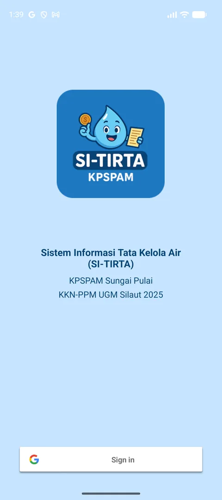
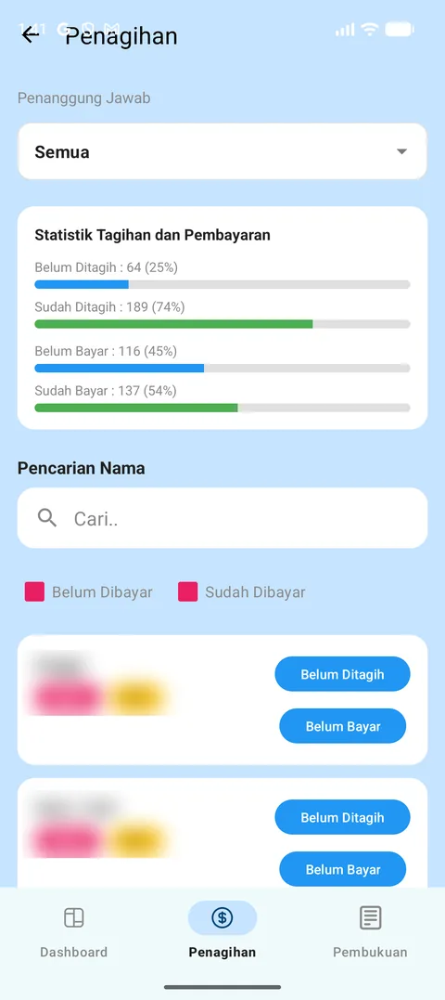
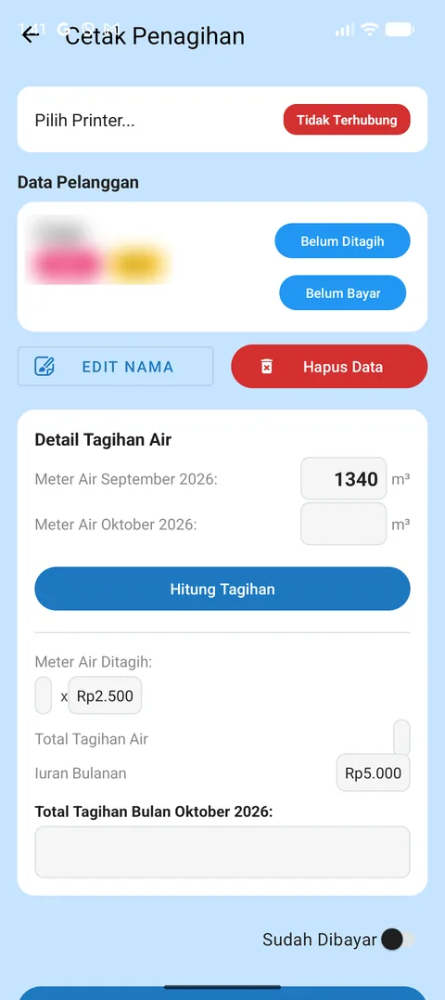
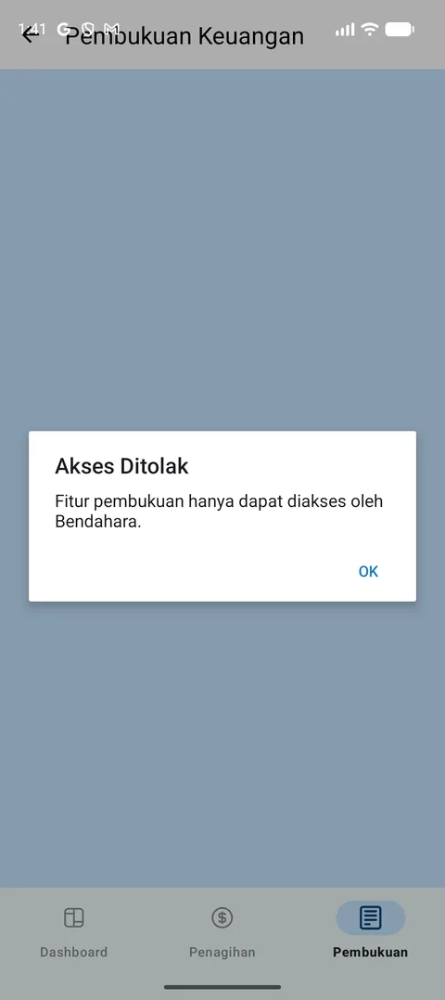

# SI-TIRTA

[](https://github.com/khrlanamm/SI-TIRTA/actions/workflows/ci.yml)


Water billing and bookkeeping app for a village water utility (KPSPAM) in West Sumatra. Used for the June 2025 payments and taught to 10 utility officers.

## Screenshots

Customer names and IDs are blurred.

| Sign-in | Billing | Bill detail | Bookkeeping |
|---|---|---|---|
|  |  |  |  |

## Features

- **Dashboard**: edit the officers in charge (penanggung jawab), add customers, and run the monthly reset, which starts a new billing month once every customer has been billed.
- **Penagihan (billing)**: billing and payment statistics, search customers, filter by officer and status, and mark bills as billed (Sudah Ditagih) or paid (Sudah Bayar). Customers not yet billed come first.
- **Cetak (print)**: enter this month's meter reading, compute the bill (usage x Rp2.500 per m³ + Rp5.000 monthly fee), and print it on a Bluetooth ESC/POS thermal printer.
- **Pembukuan (bookkeeping)**: debit and credit entries per month with income, spending, and balance. Only treasurers listed in the `bendahara` collection can open it.
- Google sign-in.

## Data and access

Data lives in Firestore: `pelanggan` (customers), `penanggung_jawab` (officers), `transaksi` (bookkeeping), and `bendahara` (treasurer emails). The security rules in [`firestore.rules`](firestore.rules) allow signed-in users only, and new sign-ups are disabled in Firebase Authentication, so only existing officer accounts can sign in. A user can read only their own `bendahara` entry.

The Firebase config (`app/google-services.json`) is committed. It is not a secret: access is controlled by the rules and the sign-up setting above.

## Stack

Kotlin, XML layouts, Navigation component, ViewModel and LiveData, Firebase Authentication and Firestore, Credential Manager, ESC/POS thermal printer library.

## Build

```sh
./gradlew :app:testDebugUnitTest   # unit tests
./gradlew :app:assembleDebug
```

Unit tests cover the bill calculation, the customer filter and statistics, and the bookkeeping totals. CI runs them on every push.

Release builds are signed in Android Studio with the upload key, which is kept outside the repo.

Deploy the security rules with the Firebase CLI:

```sh
firebase deploy --only firestore:rules
```

## License

All rights reserved. The source code is public for reference only. See [LICENSE](LICENSE).
